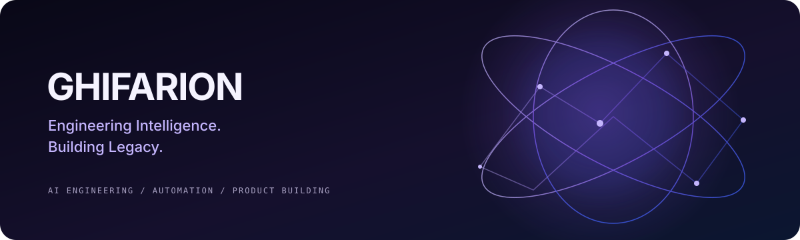

<h1 align="center">Ghifarion</h1>

<strong>Engineering Intelligence. Building Legacy.</strong>

Exploring AI engineering, intelligent automation, and software products that turn ideas into practical tools.

  
  
  

---

## About

I work at the intersection of **AI engineering, intelligent automation, and software development**. I enjoy exploring new AI tools, building useful applications, and turning rough ideas into systems that can solve real problems.

### Focus Areas

- **AI Engineering** — LLM-powered applications and applied AI
- **AI Agents & Automation** — workflows that reduce repetitive work and connect tools
- **SaaS Product Development** — taking product ideas from concept toward deployment
- **Developer Tools** — practical utilities for real-world workflows

## Featured Projects

<table>
  <tr>
    <td width="50%" valign="top">
      <h3><a href="https://github.com/progstay17/Mcap2Mp4-converter-">MCAP2MP4 Converter</a></h3>
      
Desktop and CLI tooling for converting MCAP recordings into MP4 video.

      
Developer Tool · Media Workflow

    </td>
    <td width="50%" valign="top">
      <h3><a href="https://github.com/progstay17/GDrive_bulk_down">AIT Drive Downloader</a></h3>
      
A bulk Google Drive downloader built around convenient batch-download and ZIP workflows.

      
Web App · Productivity

    </td>
  </tr>
  <tr>
    <td width="50%" valign="top">
      <h3><a href="https://github.com/progstay17/learning-resources-finder">Learning Resource Finder</a></h3>
      
A project focused on finding and organizing learning resources.

      
Learning Tools · Knowledge Workflow

    </td>
    <td width="50%" valign="top">
      <h3><a href="https://github.com/progstay17/proactive-judgement">Proactive Judgment</a></h3>
      
Principles and supporting tools for more proactive, deliberate AI-agent behavior.

      
AI Agents · Decision Principles

    </td>
  </tr>
</table>

## Brand Assets

- [Ghifarion banner](./assets/ghifarion-banner.svg)
- [Brand tokens (JSON)](./assets/brand-tokens.json)
- [Contribution guidelines](./CONTRIBUTING.md)

Use these shared assets to keep future Ghifarion pages and projects visually consistent.

## Working Philosophy

> Build with curiosity. Automate with intention. Engineer for real-world impact.

I believe good engineering is more than making something work: it is about understanding the problem, choosing the right level of complexity, and building with purpose.

---

<strong>Engineering Intelligence. Building Legacy.</strong>

Ghifarion · AI · Automation · Product Engineering

